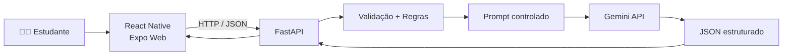

# 📚 StudyGem

### **Seu conteúdo. Seu resumo. Seu estudo.**

O **StudyGem** é uma aplicação acadêmica que usa **Inteligência Artificial** para transformar um conteúdo de estudo em um material de revisão organizado.

O estudante informa a matéria, cola o conteúdo, escolhe a quantidade de perguntas e recebe:

**Resumo → Pontos principais → Perguntas → Respostas**

---

## 🎯 O que o projeto demonstra

- Integração real com a **API Gemini**
- Frontend em **React Native + Expo Web**
- API REST em **FastAPI**
- Validação e regras de negócio no backend
- Resposta estruturada validada com **Pydantic**
- Tratamento de erros e timeout
- Testes automatizados com mocks

---

## 🧩 Como funciona



A **API Key nunca fica no frontend**. Ela é utilizada exclusivamente pelo backend.

---

## 🛠️ Tecnologias

| Camada | Tecnologias |
|---|---|
| Frontend | React Native, Expo, TypeScript, Expo Web |
| Backend | Python, FastAPI, Pydantic, Uvicorn |
| IA | Google GenAI SDK + Gemini |
| Testes | pytest + mocks |
| Documentação | Swagger / OpenAPI |

---

## ▶️ Como executar

### 1. Backend

```powershell
cd backend
python -m venv .venv
.venv\Scripts\activate
pip install -r requirements.txt
```

Crie o arquivo `.env`:

```env
GEMINI_API_KEY=sua_chave_aqui
GEMINI_MODEL=gemini-3.5-flash-lite
```

Inicie:

```powershell
uvicorn app.main:app --reload
```

API:

**http://127.0.0.1:8000**

Swagger:

**http://127.0.0.1:8000/docs**

### 2. Frontend

Em outro terminal:

```powershell
cd frontend
npm install
npm run web
```

Abra:

**http://localhost:8081**

---

## 🔌 Endpoint principal

### `POST /api/v1/study`

Exemplo:

```json
{
  "subject": "Redes de Computadores",
  "content": "O protocolo HTTP é utilizado para comunicação entre clientes e servidores na web.",
  "question_count": 5,
  "language": "pt-BR"
}
```

Resposta:

```json
{
  "subject": "Redes de Computadores",
  "summary": "...",
  "key_points": ["...", "..."],
  "questions": [
    {
      "question": "...",
      "answer": "..."
    }
  ]
}
```

### Regras principais

- assunto: **2 a 100 caracteres**
- conteúdo: **20 a 10.000 caracteres**
- perguntas: **1 a 10**
- entradas inválidas: **HTTP 422**
- falha controlada com Gemini: **HTTP 502**

---

## 🧪 Testes

```powershell
cd backend
.venv\Scripts\activate
pytest -q
```

A suíte do projeto cobre casos positivos e negativos, incluindo validações, indisponibilidade do Gemini, resposta inválida e ausência de credencial.

---

## 📁 Estrutura

```text
StudyGem/
├── backend/
│   ├── app/
│   │   ├── core/
│   │   ├── routes/
│   │   ├── schemas/
│   │   ├── services/
│   │   └── utils/
│   └── tests/
├── frontend/
│   └── src/
├── docs/
│   ├── arquitetura.md
│   ├── fluxo.md
│   └── images/
└── README.md
```

---

## 💡 Ideia central

> **Menos tempo organizando conteúdo. Mais tempo estudando.**

O StudyGem foi pensado como um pequeno produto real: simples de usar, fácil de demonstrar e com responsabilidades bem separadas entre interface, API e Inteligência Artificial.

---
